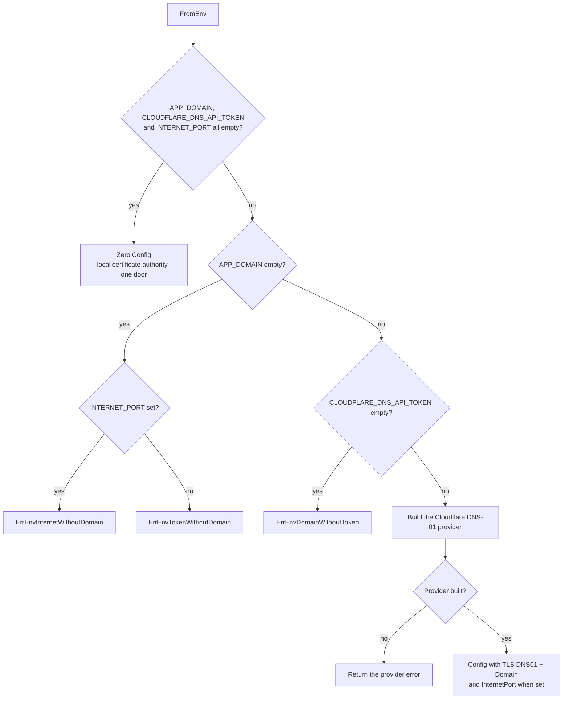

> Read AGENTS.md at the repo root before any change.

# `httpd.FromEnv`

## Context

A self-hosted webtyp app runs in Docker Compose. Its compose sets three environment variables: the name the app is
reached by (`APP_DOMAIN`), the port of the internet door that only the Cloudflare Tunnel reaches (`INTERNET_PORT`), and
the Cloudflare token that lets the server obtain a real certificate for that name by DNS-01 (`CLOUDFLARE_DNS_API_TOKEN`).
Today every app would read those three variables and build the lego Cloudflare provider itself to fill
`httpd.Config{InternetPort, TLS: TLSConfig{DNS01, Domain}}` — the same lines in every app. This plan adds
`httpd.FromEnv()`, which returns a `Config` with the doors and the certificate already filled; the app only adds its own
fields (`Authorize`, `Authn`, …) and calls `httpd.New`.

## Tools

```bash
go install webtyp.com/devflow/cmd/gotest@latest
go mod tidy
```

Environment: `GOPRIVATE=webtyp.com/*,github.com/veltylabs/*`, `GOFLAGS=-mod=mod`. The repo already requires
`github.com/go-acme/lego/v4 v4.35.2`; do not change that version.

## Ecosystem search

Searched `APP_DOMAIN`, `INTERNET_PORT`, `DNS_API_TOKEN`, `FromEnv`, `cloudflare.NewDNSProvider` over `webtyp/` and
`veltylabs/`: nothing reads them; `httpd.Config.InternetPort` and `TLSConfig.DNS01` exist and are filled by hand.
**Extend** `httpd` (the owner of both doors and of TLS). The lego Cloudflare provider already reads its own token from
the environment: **reuse** `cloudflare.NewDNSProvider()`, never re-read the token here.

## Design gate

1. **Prior art.** The twelve-factor app keeps deploy configuration in the environment (unverified: page not read in
   this session). Traefik and Caddy configure their ACME DNS-01 provider for Cloudflare from environment variables read
   by lego or the provider module (unverified). Spring Boot binds external configuration from the environment
   (unverified). This plan follows the common practice: the deployment sets variables, the server reads them once at start.
2. **Novice names.** `httpd.FromEnv()` — "the config from the environment". Constants `EnvAppDomain`,
   `EnvInternetPort`, `EnvDNSAPIToken`; errors `ErrEnvDomainWithoutToken`, `ErrEnvTokenWithoutDomain`,
   `ErrEnvInternetWithoutDomain`.
3. **Complexity ledger.** Concepts +1 (`FromEnv`) · files an app touches −0/+0 · call-site lines −3 (no provider, no
   three `Getenv`) · ways to do the same thing: +0 for Cloudflare deployments; setting `TLSConfig.DNS01` by hand stays
   only for another DNS vendor (documented as such).
4. **Where it belongs.** `server/httpd`, owner of `Config`, the two doors and TLS.
5. **Deletes.** Nothing in this repo; apps delete their hand-written provider wiring when they adopt it.

## APIs used

| Symbol | Exact signature / value | Tag | File |
|---|---|---|---|
| `cloudflare.NewDNSProvider` | `func NewDNSProvider() (*DNSProvider, error)` — reads `CLOUDFLARE_DNS_API_TOKEN` (or `CLOUDFLARE_EMAIL` + `CLOUDFLARE_API_KEY`); builds a client, does not call the network | `github.com/go-acme/lego/v4` v4.35.2 | `providers/dns/cloudflare/cloudflare.go:100` |
| `cloudflare.EnvDNSAPIToken` | `"CLOUDFLARE_DNS_API_TOKEN"` (`envNamespace + "DNS_API_TOKEN"`) | v4.35.2 | `cloudflare.go:28` |
| `httpd.Config` | fields used: `InternetPort string`, `TLS TLSConfig` | this repo | `httpd/httpd.go:18` |
| `httpd.TLSConfig` | fields used: `DNS01 challenge.Provider`, `Domain string` | this repo | `httpd/tls.go:17` |

`*cloudflare.DNSProvider` satisfies `challenge.Provider`. If a signature in the published tag differs from this table,
stop and name the symbol in the PR; never adapt it by guessing.

## Stage 1 — diagram: `docs/diagrams/FROM_ENV_FLOW.md` (new)

Write exactly this file:

````markdown
# FromEnv flow

`httpd.FromEnv()` reads the doors and the certificate of a self-hosted server from the environment that its Docker
Compose sets. Every branch below has a test in `tests/fromenv_test.go`.


````

Link it from `docs/ARCHITECTURE.md` (stage 4). Commit after this stage.

## Stage 2 — tests first: `tests/fromenv_test.go` (new, `package server_test`)

Written before the code: after this stage `gotest` fails to compile (`httpd.FromEnv` does not exist yet) — expected.

```go
package server_test

import (
	"testing"

	"webtyp.com/server/httpd"
)

const (
	testDomain   = "app.example.com"
	testToken    = "test-token-not-real"
	testInternet = "8443"
)

// setEnv sets the three variables FromEnv reads, and clears lego's alternative
// credentials so the machine running the tests cannot change the result.
func setEnv(t *testing.T, domain, token, internet string) {
	t.Helper()
	t.Setenv(httpd.EnvAppDomain, domain)
	t.Setenv(httpd.EnvDNSAPIToken, token)
	t.Setenv(httpd.EnvInternetPort, internet)
	for _, k := range []string{"CLOUDFLARE_EMAIL", "CLOUDFLARE_API_KEY", "CF_API_EMAIL", "CF_API_KEY", "CF_DNS_API_TOKEN", "CLOUDFLARE_ZONE_API_TOKEN", "CF_ZONE_API_TOKEN"} {
		t.Setenv(k, "")
	}
}

func TestFromEnv(t *testing.T) {
	cases := []struct {
		name                     string
		domain, token, internet  string
		wantErr                  string
		wantDNS01                bool
		wantDomain, wantInternet string
	}{
		{name: "nothing set: zero config", wantDNS01: false},
		{name: "domain and token: certificate, one door", domain: testDomain, token: testToken, wantDNS01: true, wantDomain: testDomain},
		{name: "domain, token and internet port: both doors", domain: testDomain, token: testToken, internet: testInternet, wantDNS01: true, wantDomain: testDomain, wantInternet: testInternet},
		{name: "domain without token", domain: testDomain, wantErr: httpd.ErrEnvDomainWithoutToken},
		{name: "token without domain", token: testToken, wantErr: httpd.ErrEnvTokenWithoutDomain},
		{name: "internet port without domain", internet: testInternet, wantErr: httpd.ErrEnvInternetWithoutDomain},
		{name: "internet port and token without domain", token: testToken, internet: testInternet, wantErr: httpd.ErrEnvInternetWithoutDomain},
	}
	for _, c := range cases {
		t.Run(c.name, func(t *testing.T) {
			setEnv(t, c.domain, c.token, c.internet)
			cfg, err := httpd.FromEnv()
			if c.wantErr != "" {
				if err == nil || err.Error() != c.wantErr {
					t.Fatalf("got error %v, want %q", err, c.wantErr)
				}
				return
			}
			if err != nil {
				t.Fatalf("FromEnv: %v", err)
			}
			if (cfg.TLS.DNS01 != nil) != c.wantDNS01 {
				t.Fatalf("DNS01 set = %v, want %v", cfg.TLS.DNS01 != nil, c.wantDNS01)
			}
			if cfg.TLS.Domain != c.wantDomain || cfg.InternetPort != c.wantInternet {
				t.Fatalf("got Domain %q InternetPort %q, want %q %q", cfg.TLS.Domain, cfg.InternetPort, c.wantDomain, c.wantInternet)
			}
		})
	}
}
```

Commit after this stage.

## Stage 3 — `httpd/env.go` (new)

Write exactly this file:

```go
//go:build !wasm

package httpd

import (
	"errors"
	"os"

	"github.com/go-acme/lego/v4/providers/dns/cloudflare"
)

// Environment variables FromEnv reads; the Docker Compose of a self-hosted app sets them.
const (
	// EnvAppDomain is the name the app is reached by, inside and outside, e.g. "app.example.com".
	EnvAppDomain = "APP_DOMAIN"
	// EnvInternetPort is the port of the internet door, reached only by the tunnel.
	EnvInternetPort = "INTERNET_PORT"
	// EnvDNSAPIToken is the Cloudflare token (Zone Read + DNS Edit on that domain) used to obtain its certificate.
	EnvDNSAPIToken = cloudflare.EnvDNSAPIToken
)

// Errors returned by FromEnv; compare with err.Error().
const (
	ErrEnvDomainWithoutToken    = "APP_DOMAIN is set but CLOUDFLARE_DNS_API_TOKEN is not: the certificate for APP_DOMAIN cannot be obtained"
	ErrEnvTokenWithoutDomain    = "CLOUDFLARE_DNS_API_TOKEN is set but APP_DOMAIN is not: there is no name to obtain a certificate for"
	ErrEnvInternetWithoutDomain = "INTERNET_PORT is set but APP_DOMAIN is not: the tunnel verifies the certificate of APP_DOMAIN, so the internet door needs it"
)

// FromEnv returns the doors and the certificate of a self-hosted server, read
// from the environment. With none of the three variables set it returns the
// zero Config (local certificate authority, one door), as in development.
//
// Example:
//
//	cfg, err := httpd.FromEnv()
//	if err != nil { return err }
//	cfg.Authorize = authorize
//	srv := httpd.New(cfg)
func FromEnv() (Config, error) {
	domain := os.Getenv(EnvAppDomain)
	token := os.Getenv(EnvDNSAPIToken)
	internet := os.Getenv(EnvInternetPort)

	var c Config
	switch {
	case domain == "" && token == "" && internet == "":
		return c, nil
	case domain == "" && internet != "":
		return c, errors.New(ErrEnvInternetWithoutDomain)
	case domain == "":
		return c, errors.New(ErrEnvTokenWithoutDomain)
	case token == "":
		return c, errors.New(ErrEnvDomainWithoutToken)
	}

	provider, err := cloudflare.NewDNSProvider()
	if err != nil {
		return c, err
	}
	c.InternetPort = internet
	c.TLS = TLSConfig{DNS01: provider, Domain: domain}
	return c, nil
}
```

Run `gotest`: all seven cases pass. Commit after this stage.

## Stage 4 — docs

- `docs/ARCHITECTURE.md`, section "TLS": after the paragraph that says the app injects `challenge.Provider` into
  `TLSConfig.DNS01`, add: for Cloudflare — the provider self-hosted webtyp apps use — `httpd.FromEnv()` builds it from
  the environment; injecting `TLSConfig.DNS01` by hand remains only for another DNS vendor. Link
  `docs/diagrams/FROM_ENV_FLOW.md`.
- `README.md`: a short section **Self-hosted server (environment)** with one row per variable — what it is in one plain
  sentence, where it comes from, and what breaks without it (the exact error text):

| Variable | What it is | Where it comes from | Without it |
|---|---|---|---|
| `APP_DOMAIN` | The name the app is reached by, inside the office network and from the internet | The deployment's compose | No real certificate; with a token or an internet port set, `FromEnv` returns the matching error |
| `CLOUDFLARE_DNS_API_TOKEN` | Cloudflare token allowed to edit DNS of that domain, used only to obtain the certificate | Created once in the Cloudflare dashboard (Zone Read + DNS Edit, that zone only); stored only on the server | `ErrEnvDomainWithoutToken` |
| `INTERNET_PORT` | Port of the internet door, reached only by the tunnel | The deployment's compose | No internet door; the app is reachable only inside the network |

Use `app.example.com` in every example; never a real customer domain. Commit after this stage.

## Delivery check

1. `gotest` passes (it builds, vets and runs every test). A PR that does not compile, or whose tests could not run, is a failed delivery.
2. `grep -n "FromEnv" README.md docs/ARCHITECTURE.md docs/diagrams/FROM_ENV_FLOW.md` → a match in each.
3. `git diff --stat main` lists only: `httpd/env.go`, `tests/fromenv_test.go`, `docs/diagrams/FROM_ENV_FLOW.md`,
   `docs/ARCHITECTURE.md`, `README.md`, and `go.mod`/`go.sum` only if `go mod tidy` changed them.

## Delivery rules

- Never pause to ask permission or report progress: when the delivery check passes, commit, push and open the PR. Stuck
  for 30 minutes: open the PR anyway, listing what fails.
- Commit after every stage. Never run `git reset`, `git restore`, `git checkout -- <file>` or `git stash` on your own work.
- Do not change `httpd.New`, `Config`, `TLSConfig` or `dns01.go`: `FromEnv` only fills existing fields.

## Stages

| # | Files | Result |
|---|---|---|
| 1 | `docs/diagrams/FROM_ENV_FLOW.md` | The flow, one branch per test |
| 2 | `tests/fromenv_test.go` | Seven cases: three successes, four failures (red: does not compile yet) |
| 3 | `httpd/env.go` | `FromEnv`; all green |
| 4 | `docs/ARCHITECTURE.md`, `README.md` | Variables documented |
