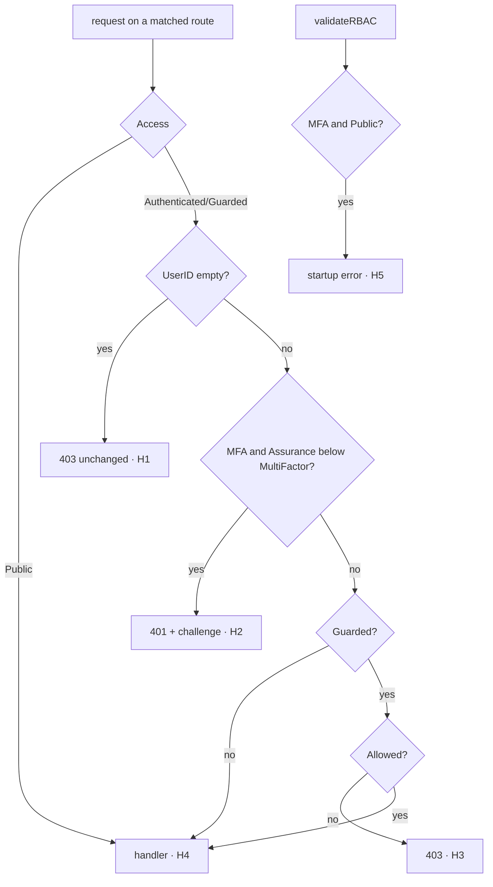

> This plan is dispatched via the CodeJob workflow. See skill: agents-workflow.

# Plan — httpd: multi-factor routes

Master plan: `SECURITY_BY_DEFAULT_MASTER_PLAN.md` in the maintainer's
workspace (not published; everything you need is restated here).

## Why

`webtyp.com/router` (new tag) adds three things:
- `Route.RequiresMFA()`;
- `RouteInfo.MFA bool`;
- `Context.SetAssurance(model.Assurance)` / `Context.Assurance()`.

It also adds the constants `router.HeaderWWWAuthenticate`,
`router.ChallengeMFARequired` and `router.ErrMsgPublicRequiresMFA`, plus new
conformance clauses. `httpd` implements `router.Router`, `router.Route` and
`router.Context`, so it must implement and **enforce** them, or it stops
compiling against the new router.

Semantics (from the router contract, enforce exactly this):
1. Anonymous caller on a non-public route → **403**, as today, unchanged.
2. Identified caller on a route with `MFA == true` and
   `ctx.Assurance() < model.AssuranceMultiFactor` → **401**, response header
   `WWW-Authenticate: <router.ChallengeMFARequired>`, body `"Unauthorized\n"`.
   The handler and the route's `Use` middlewares do not run.
3. Then the existing permission check (Guarded → `model.Allowed`) → 403 when
   denied.
4. At startup (`validateRBAC`), a route with `MFA && Access == model.AccessPublic`
   is an error:
   `fmt.Errorf("route %s %s %s", method, path, router.ErrMsgPublicRequiresMFA)`.

`model.Assurance` values: `AssuranceNone` (0), `AssuranceSingleFactor`,
`AssuranceMultiFactor`.

## Constraints (from AGENTS.md, restated)

- Tests: black-box tests go in `tests/` (package `tests`). A test that needs
  unexported identifiers lives next to the code in its own package.
  `httpd/conformance_test.go` is such a test and stays where it is. Never
  export a symbol for a test.
- `httpd` is native-only (`net/http`) and may use the standard library.
- Never serve files outside the router (`http.FileServer` is forbidden).
- Use `gotest`, not `go test`.

## Stage 1 — bump and implement

1. `go get webtyp.com/router@latest webtyp.com/model@latest`. If
   `router.Route` has no `RequiresMFA`, **stop**: the router plan has not
   shipped yet.
2. `httpd/adapter.go`:
   - `httpContext`: field `assurance model.Assurance`; `SetAssurance` stores
     it; `Assurance()` returns `model.AssuranceNone` when `c.UserID() == ""`,
     else the stored value.
   - `httpRoute.RequiresMFA()`: `r.info.MFA = true; return r`.
   - In the gate (the `switch route.info.Access` closure, step "2. Apply
     RBAC"), for `AccessAuthenticated` and the default (`AccessGuarded`)
     branches, insert **after** the `ctx.UserID() == ""` check and **before**
     the permission check:
     ```go
     if route.info.MFA && ctx.Assurance() < model.AssuranceMultiFactor {
         ctx.SetHeader(router.HeaderWWWAuthenticate, router.ChallengeMFARequired)
         ctx.WriteStatus(http.StatusUnauthorized)
         ctx.Write([]byte(bodyUnauthorized))
         return
     }
     ```
     Declare `bodyUnauthorized = "Unauthorized\n"` next to wherever
     `"Forbidden\n"` is used. If `"Forbidden\n"` is a bare literal, make it a
     constant `bodyForbidden` in the same change.
3. `httpd/enforce.go` `validateRBAC`: first check in the loop:
   ```go
   if r.info.MFA && r.info.Access == model.AccessPublic {
       return fmt.Errorf("route %s %s %s", r.info.Method, r.info.Path, router.ErrMsgPublicRequiresMFA)
   }
   ```

## Stage 2 — conformance driver (`httpd/conformance_test.go`)

The router's `conformance.ServeFunc` now receives `who conformance.Identity`
(`UserID string`, `Assurance model.Assurance`) instead of `userID string`,
and `conformance.Response` gained `Challenge string`. Update the factory:
- Add the constant `conformanceAssuranceHeader = "X-Conformance-Assurance"`.
- The driver sets `conformanceUserHeader` from `who.UserID` (when not empty)
  and `conformanceAssuranceHeader` from `fmt.Sprint(uint8(who.Assurance))`.
- The test `Authn` parses that header back into `model.Assurance` and calls
  `ctx.SetAssurance`. A missing or invalid header means `AssuranceNone`.
- Fill `conformance.Response.Challenge` from
  `res.Header.Get(router.HeaderWWWAuthenticate)`.
- Do the same for `ServeOp` if the factory defines it.

## Branch diagram



| Branch | Test |
|---|---|
| H1–H5 | the router conformance clauses `mfa_route_rejects_anonymous_without_challenge`, `mfa_route_rejects_single_factor_with_challenge`, `mfa_route_still_checks_permission`, `mfa_route_serves_multi_factor_identity`, `mfa_on_authenticated_route`, `public_mfa_route_fails_at_startup`, run by `TestHTTPDConformance` |
| a `Stream` route declared `.Authenticated().RequiresMFA()` is gated like any route | `tests/assurance_test.go`: single-factor caller → 401 + challenge, the stream handler never runs (`httpStreamer` embeds `*httpContext`, so it gets `Assurance` for free; the gate is the same closure) |
| `Assurance()` is None for an anonymous context even if set | `tests/assurance_test.go`: real `httpd.Server` with an `Authn` that calls `SetAssurance(MultiFactor)` without `SetUserID` on an `.Authenticated().RequiresMFA()` route → 403 (anonymous wins) |

## Stages

| # | Files | Done when |
|---|---|---|
| 1 | `go.mod`, `go.sum`, `httpd/adapter.go`, `httpd/enforce.go` | compiles against the new router |
| 2 | `httpd/conformance_test.go`, `tests/assurance_test.go` | all conformance clauses green |
| 3 | `README.md` (access section: one line on `RequiresMFA` and the 401 challenge) | docs match |

## Acceptance criteria

- `gotest` green.
- `grep -rn '"Forbidden\\n"' httpd/` → only the constant declaration.
- Before opening the PR: `git diff --stat main` lists every file of the
  stages table, and no file is deleted that this plan does not order deleted.
