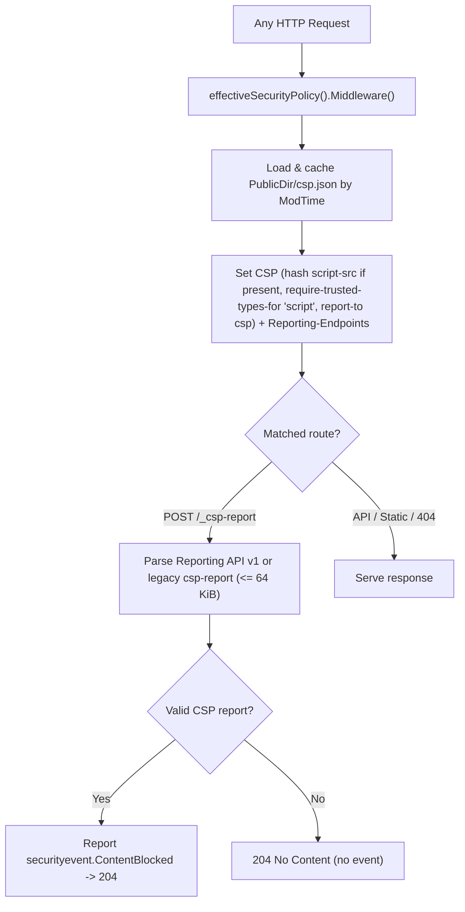

# Strict CSP Enforcement & Violation Reporting (`server/httpd`)

Context: `server/httpd` enforces `router/security.Policy` on every HTTP response, reads script SHA-384 hashes from `PublicDir/csp.json`, and mounts `POST /_csp-report` to convert browser violation reports into `securityevent.ContentBlocked`.

## Walkthrough

1. `wrapWithGlobalBatteries` wraps every handler in `s.effectiveSecurityPolicy().Middleware()`, ensuring API routes, static files, and 404 responses carry strict security headers and the 413 body cap.
2. `loadCSPHashes` reads `filepath.Join(PublicDir, "csp.json")` and caches it by file `ModTime` so hot-reloads in `webtyp dev` pick up updated script hashes immediately.
3. `POST /_csp-report` accepts both `application/reports+json` (W3C Reporting API v1) and `application/csp-report`, reports `securityevent.ContentBlocked` via `Config.Report`, and returns `204 No Content`.
